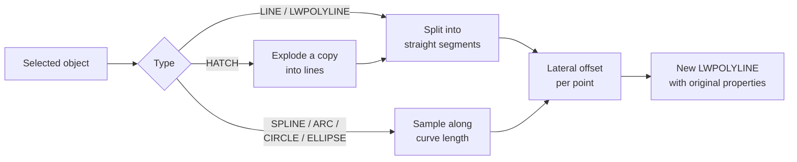

# SketchLine — Hand-Sketch Routine for AutoCAD

Author: Siniša Svoger · Version 6

## Overview

SketchLine (file `SketchLine.lsp`, version 6) is an AutoLISP routine that replaces precise CAD geometry with lines that look drawn by hand, like pencil on grid paper. Each selected object is redrawn as a new LWPOLYLINE whose path follows the original but carries a controlled, random irregularity.

| Object type | Handling |
| --- | --- |
| LINE | Converted, endpoints kept exact |
| LWPOLYLINE | Each straight segment converted separately; corners stay closed |
| SPLINE, ARC, CIRCLE, ELLIPSE | Sampled along the curve; wobble applied perpendicular to it |
| HATCH (pattern) | A copy is exploded; every hatch line is converted |
| HATCH (SOLID, gradient) | Skipped and reported |
| TEXT, MTEXT (with `SKETCHTEXT`) | Split into single characters with random position, rotation and height |

The new polylines inherit layer, colour (including true colour), linetype, linetype scale, lineweight and space (model or layout) from the original object.

## Installation

SketchLine runs in full AutoCAD and in AutoCAD LT 2024 or newer; older LT versions have no LISP support. Save `SketchLine.lsp` in a permanent folder first, for example `C:\AutoCAD_LISP\`.

**Option 1 – current session only**

1. Type `APPLOAD` and press Enter.
2. Select `SketchLine.lsp` and click **Load**.
3. Confirm the security prompt with **Load Once** or **Always Load**.

Dragging the file from Windows Explorer into the drawing window does the same. The routine stays loaded only in that drawing.

**Option 2 – load automatically (recommended)**

1. Type `APPLOAD`.
2. Under **Startup Suite**, click **Contents…**, then **Add…**.
3. Select `SketchLine.lsp` and click **Close**.

**Option 3 – trusted location (removes the security warning)**

1. Type `OPTIONS` and open the **Files** tab.
2. Add the folder under **Trusted Locations**.
3. Add the same folder under **Support File Search Path**, then click **Apply**.

When the system variable `SECURELOAD` is 2, AutoCAD loads LISP only from trusted locations, so Option 3 is required.

To update to a new version, load the new file with `APPLOAD`; it replaces the old functions immediately.

## Quick start

A first conversion takes four steps and uses the default **Fine** style.

1. Load `SketchLine.lsp` (see Installation).
2. Type `SKETCHLINE`.
3. Select the objects (window selection works; lines, curves and hatches can be mixed) and press Enter.
4. Check the result. A single `U` undoes the whole conversion.

To change the look, run `SKETCHSET` before step 2. Convert the drawing as the last step, when geometry is final, because the result is no longer editable as the original lines, curves or hatches.

## Commands

The routine defines three commands: `SKETCHLINE` converts lines, curves and hatches, `SKETCHTEXT` converts text and `SKETCHSET` sets the parameters for both.

### SKETCHLINE

Prints the active settings on the command line, asks for a selection and converts every supported object in it. Objects on locked layers are ignored. When finished it reports the number of converted objects, converted hatch lines and skipped solid or gradient hatches. The whole run is one undo step.

### SKETCHTEXT

Asks for a selection of TEXT and MTEXT objects and converts each into single-character TEXT objects (see Hand-lettered text). It reports the number of converted text objects and created characters. The whole run is one undo step.

### SKETCHSET

Asks for the settings in this order; Enter keeps the value shown in angle brackets.

| Prompt | Input | Default |
| --- | --- | --- |
| Style | Fine / Medium / Rough / Loose / Custom | Fine |
| Slow drift | % of length (Custom only) | from preset |
| Tremor | % of length (Custom only) | from preset |
| Micro jitter | % of length (Custom only) | from preset |
| End freedom | % of length (Custom only) | from preset |
| End overshoot | % of length (Custom only) | from preset |
| Variability | 0–1 (Custom only) | from preset |
| Text: baseline shift | % of text height (Custom only) | from preset |
| Text: letter rotation | degrees (Custom only) | from preset |
| Text: letter height variation | % (Custom only) | from preset |
| Text: spacing variation | % of text height (Custom only) | from preset |
| Text: baseline wave | % of text height (Custom only) | from preset |
| Absolute max wobble | drawing units, 0 = no limit (Custom only) | 0 |
| Strokes per segment | whole number ≥ 1 (not used for hatches or text) | 1 |
| Delete original objects | Yes / No | Yes |

Settings stay active until AutoCAD is closed; after a restart the Fine style is used again.

## Parameters and presets

All distances are percentages of the length of the segment or curve being converted, so the look is the same at any drawing scale or unit.

| Parameter | Effect | Useful range |
| --- | --- | --- |
| Slow drift | Large, gentle waves (1.5–4.5 per line, random) | 0.1–1.5 % |
| Tremor | Finer hand shake (25–55 waves per line; 8–16 on hatch lines) | 0.05–0.4 % |
| Micro jitter | Uncorrelated roughness at every vertex, like pencil grain | 0–0.15 % |
| End freedom | Random sideways shift of each end; the stroke tilts slightly | 0–1.0 % |
| End overshoot | Random extension past each endpoint (never on hatch lines) | 0–2 % |
| Variability | Random per-line scaling of drift and tremor, 0 = all lines equal | 0–1 |
| Absolute max wobble | Upper limit in drawing units for drift, tremor and jitter | 0 = off |
| Strokes per segment | Independent strokes drawn over the same path | 1–3 |

| Style | Drift | Tremor | Jitter | End freedom | Overshoot | Variability |
| --- | --- | --- | --- | --- | --- | --- |
| Fine (default) | 0.25 % | 0.08 % | 0 | 0 | 0 | 0.3 |
| Medium | 0.60 % | 0.15 % | 0.03 % | 0 | 0 | 0.5 |
| Rough | 1.20 % | 0.30 % | 0.08 % | 0.5 % | 1.5 % | 0.6 |
| Loose | 1.00 % | 0.35 % | 0.12 % | 1.0 % | 1.0 % | 0.9 |

Fine and Medium keep every endpoint exactly on the original geometry. Rough and Loose let ends move and overshoot, so corners are no longer exactly closed.

## How it works

Every stroke is a sequence of points on the original path, each shifted sideways (along the local normal) by a random lateral offset.

The lateral offset at the normalised position s (0 at the start, 1 at the end) and path distance d is:

$$
h(s) = w(s)\,\bigl[a_1 N_1(d) + a_2 N_2(d) + a_3 r\bigr] + e_1 (1 - s) + e_2 s
$$

- a1, a2, a3 are the drift, tremor and jitter amplitudes; a1 and a2 are multiplied by a random factor 1 ± variability for each line.
- N1 and N2 are smooth 1D value-noise functions with cosine interpolation between random knots in the range −1 to 1; their wavelengths are random per line.
- r is a new uniform random number in −1 to 1 at every vertex (micro jitter).
- w(s) is an envelope that is 0 at both ends and rises to 1 over the first and last 8 % of the length (smoothstep), which pins the endpoints.
- e1 and e2 are the random sideways end offsets set by End freedom.

Random numbers come from a Park–Miller generator seeded from the system timer, so every run gives a different result. Straight segments get 20–400 vertices, curves 40–800 and hatch lines 36.

## Object-specific behaviour

### Lines and polylines

Each straight segment becomes its own stroke, so polyline corners are drawn as separate strokes meeting at the vertex. Closed polylines include the closing segment. Arc segments (bulges) inside a polyline are treated as straight; explode such polylines first so their arcs are converted as ARC objects.

### Splines, arcs, circles and ellipses

The curve is walked by arc length with `vlax-curve` functions, and the offset is applied along the normal at each point, so the shape is preserved. On open curves, overshoot continues along the end tangent. On closed curves, overshoot runs along the curve past the seam, like a hand-drawn circle; with Fine or Medium the seam closes exactly.

### Hatches

A copy of the hatch is exploded, every resulting line is converted with 1 stroke, no overshoot and 36 vertices, and the exploded pieces are removed. The original hatch is deleted only when "Delete original objects" is Yes. The result is a set of polylines and no longer follows changes to the hatch boundary.

### Hand-lettered text (SKETCHTEXT)

Hand lettering looks hand-made because no two letters are identical, so `SKETCHTEXT` varies each character rather than adding line wobble. Every character becomes its own TEXT object, placed along the original baseline and given small random deviations.

| Style | Baseline shift | Letter rotation | Height variation | Spacing variation | Baseline wave |
| --- | --- | --- | --- | --- | --- |
| Fine | ±2.0 % | ±1.5° | ±3 % | ±3 % | 3 % |
| Medium | ±3.5 % | ±3.0° | ±5 % | ±5 % | 5 % |
| Rough | ±5.0 % | ±4.0° | ±7 % | ±6 % | 7 % |
| Loose | ±6.0 % | ±5.0° | ±8 % | ±8 % | 8 % |

Baseline shift, spacing and wave are percentages of the text height. The baseline wave is a slow noise curve with a wavelength of 5–10 text heights, like writing without a ruler.

- Character positions come from `textbox`, so they follow the real advance widths of the font, including width factor and oblique angle.
- Layer, colour, text style, width factor, oblique angle and mirror flags are kept; every character is left-justified from the original baseline.
- Special codes `%%d`, `%%c`, `%%p`, `%%nnn` and `\U+xxxx` stay single characters; the underline and overline toggles `%%u` and `%%o` are removed.
- MTEXT is exploded to TEXT first, so inline MTEXT formatting (fonts, colours, stacking) follows AutoCAD's EXPLODE result.
- The best result comes from combining `SKETCHTEXT` with a handwriting font in the text style, such as Ink Free, Segoe Print or Architects Daughter.

## Recommended settings

| Goal | Style / Custom values | Strokes |
| --- | --- | --- |
| Clean pencil drawing on grid paper | Fine | 1 |
| Random, but exact dimensions and closed corners | Custom: drift 0.5, tremor 0.2, jitter 0.08, end freedom 0, overshoot 0, variability 0.8 | 1 |
| Quick concept sketch | Loose | 2 |
| Hand-made look of hatches (lines not quite parallel) | Custom: end freedom 0.5–1.0, other values as Fine | 1 |
| Very long lines that wobble too much | Any style + Absolute max wobble, e.g. 0.5 mm | 1–2 |

Set "Delete original objects" to No and freeze the original layer when you may need to repeat the conversion after changes.

## Limitations and troubleshooting

**Limitations**

- Geometry must lie in a plane parallel to the WCS XY plane (standard 2D drafting); lines use the Z value of their start point.
- Line thickness cannot vary along one polyline, so pencil pressure is imitated only with 2 strokes.
- Dense hatches can produce thousands of polylines and a large file; check the hatch scale first.
- After `SKETCHTEXT` each character is a separate TEXT object, so the string can no longer be edited as a whole; keep the original text (Delete = No, frozen layer) if changes are likely.
- Settings are not saved between AutoCAD sessions, and results cannot be reproduced exactly (no fixed seed).

| Symptom | Cause | Remedy |
| --- | --- | --- |
| `Unknown command "SKETCHLINE"` | File not loaded in this drawing | Load with `APPLOAD` or add to Startup Suite |
| `no function definition: VLAX-GET-ACAD-OBJECT` | Visual LISP not available (old version or other CAD program) | Use full AutoCAD or LT 2024+ |
| File does not load, no message | `SECURELOAD` = 2 | Add the folder to Trusted Locations |
| Line looks shaky or wavy | Style too strong for the drawing | Use Fine, or Custom with lower drift and tremor |
| Lines go past the corners | Overshoot or End freedom above 0 | Set both to 0 (Fine or Medium) |
| Some objects not converted | Locked layer or unsupported type (e.g. 3D polyline, MLINE) | Unlock the layer; explode or convert the objects to lines first |
| Hatch skipped | SOLID or gradient fill | Replace it with a pattern hatch such as ANSI31 |

## Version history

| Version | Changes |
| --- | --- |
| v6 | `SKETCHTEXT` for TEXT and MTEXT: per-character baseline, rotation, height and spacing variation plus a baseline wave; text parameters in presets and Custom |
| v5 | SPLINE, ARC, CIRCLE and ELLIPSE support; overshoot follows closed curves past the seam |
| v4 | Variability, micro jitter and end freedom; random wavelengths per line; Loose preset |
| v3 | HATCH support: pattern hatches exploded and converted; SOLID and gradient skipped |
| v2 | Endpoints pinned, no bow, wobble as % of length; Fine, Medium and Rough presets |
| v1 | First version: LINE and LWPOLYLINE, fixed amplitude in drawing units |
